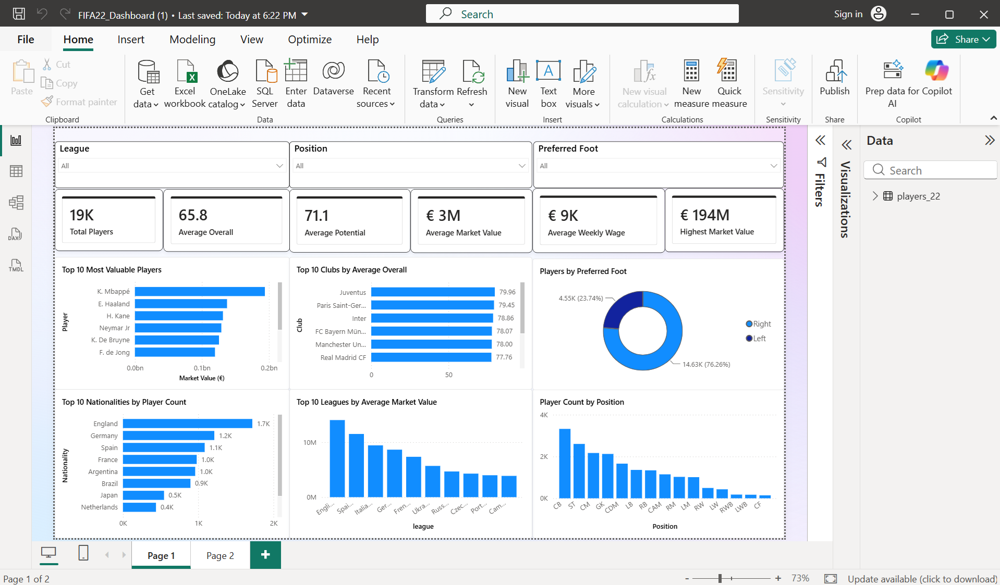

# Football Player Market Value Analysis

## Project Overview
Analysed 19,165 FIFA 22 players across 55 leagues using SQL, Python, and Power BI to identify undervalued young talents and market trends.

## Dashboard

## Tools Used
* PostgreSQL — data querying and analysis
* Python (Pandas, Matplotlib, Seaborn) — EDA and visualization
* Power BI — interactive dashboard

## Business Questions Answered
1. Which young players (age < 23) are undervalued despite high potential?
2. Which league has the highest average player value?
3. Which position earns the most?
4. Which nationality has the highest average market value?
5. Does age affect market value?
6. Who are the top 10 highest valued players?

## Key Insights
* 151 players are under 23 with potential >= 85. R. Lavia (17, €1.2M) and Gavi (16, €2.1M) are among the cheapest despite potential of 85
* English Premier League has the highest average player value (€14M), followed by La Liga (€11.5M) and Serie A (€9.4M)
* Centre Forwards earn the most (€21,611/week). Only positions with 100+ players were compared
* With a minimum of 30 players per nationality, Italy (€6.3M) has the highest average value, followed by Algeria and Portugal. Without this filter Egypt tops the list, but it has only 12 players and Salah skews the average
* Mbappe is the highest valued player (€194M) while Messi has the highest overall rating (93) but is valued at only €78M due to his age (34)
* Age and market value have almost no correlation (0.04). Overall rating, potential and league matter more

## Recommendations
* A club with a limited budget should look at young players with potential >= 85 and value under €3M, like Lavia, Gavi and Scarlett
* Scouting should focus on Italy, Portugal and Spain, which consistently produce high-value players

## Files
* `fifa22.py` — Python analysis script
* `fifa22_sql.sql` — SQL queries with comments
* `FIFA22_Dashboard.pbix` — Interactive Power BI dashboard
* `dashboard.png` — dashboard screenshot

## Dataset
FIFA 22 Complete Player Dataset — 19,239 players, 110 attributes (19,165 after removing free agents and missing values).
Source: Kaggle (stefanoleone992/fifa-22-complete-player-dataset)
